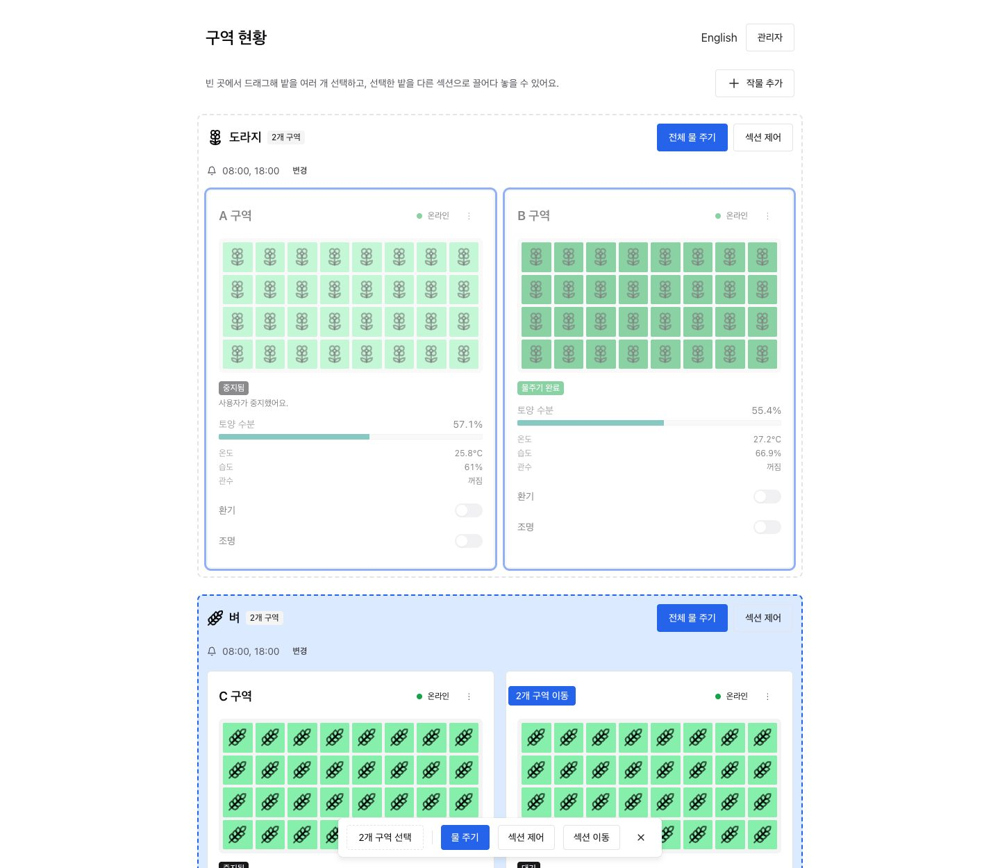
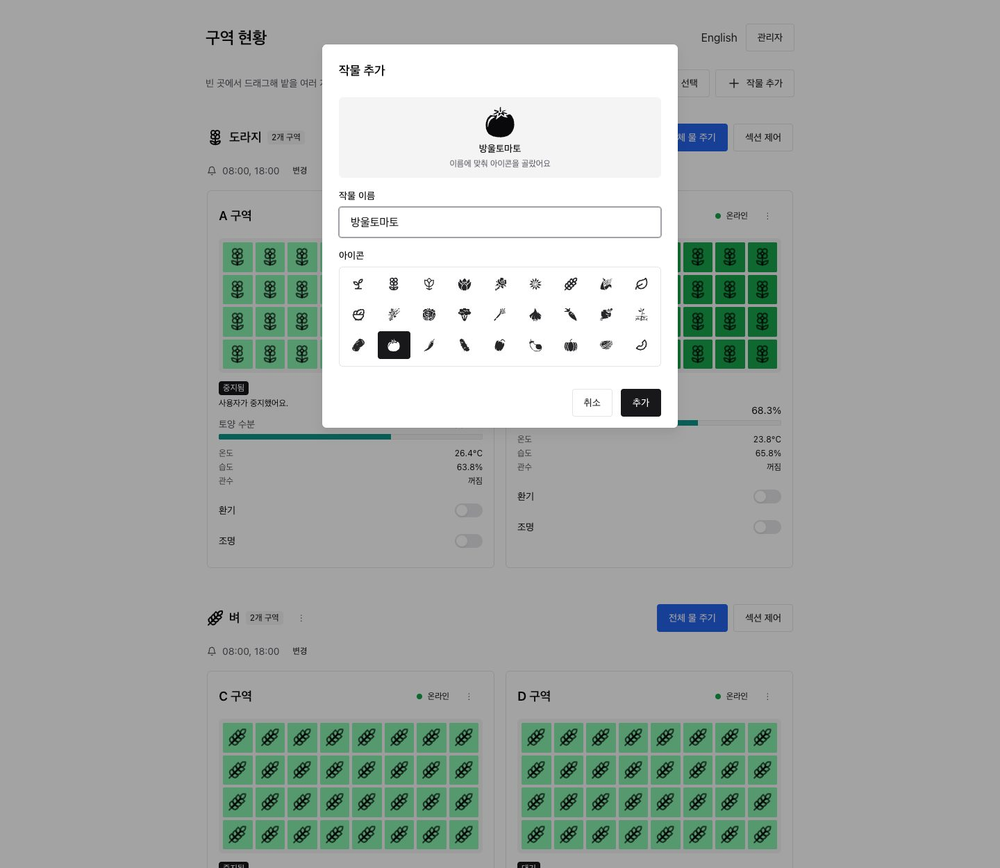
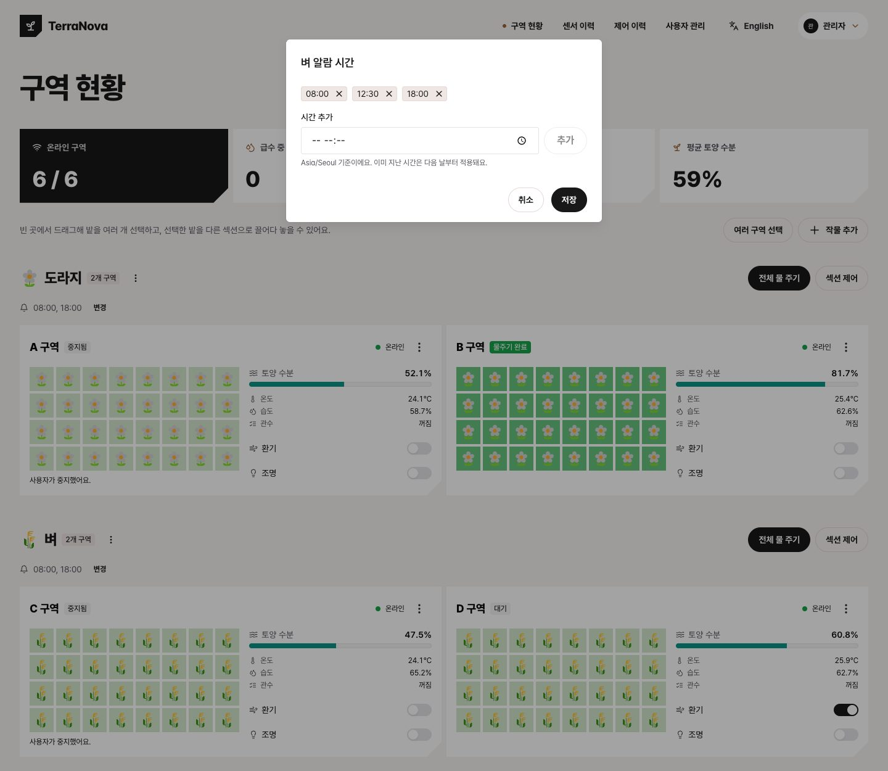
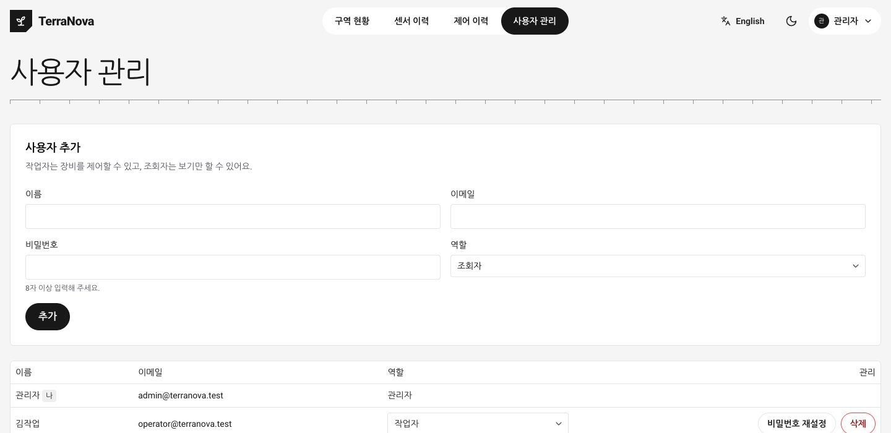

# TerraNova

[](https://github.com/ryushin01/TerraNova/actions/workflows/ci.yml)

스마트팜 제어 애플리케이션입니다. 밭을 그리드로 보여 주고, 정해진 시각에 알람을 보내며, 사람이 확인하면 물을 줍니다.

> **프로젝트 상태:** 개발 중입니다. 실제 장비 없이 MQTT 시뮬레이터로 로컬에서 실행하며, 배포는 하지 않습니다.

## 기술 스택


| 구분 | 사용 기술 |
|---|---|
| 웹 | Next.js 16, React 19, Chakra UI 3, next-intl, react-icons |
| 백엔드 | Bun, Socket.IO, Aedes(MQTT 브로커), Better Auth |
| 데이터 | PGlite, Drizzle ORM |
| 장비 통신 | MQTT (시뮬레이터로 대체) |
| 공통 | TypeScript 7, Bun workspaces, Bun test, Playwright |

## 화면

화면의 구역, 센서 값, 계정은 모두 시뮬레이터와 테스트용 데이터입니다.

| 급수 현황 | 밭 우클릭 메뉴 |
|---|---|
|  |  |

| 드래그 선택 | 다른 섹션으로 끌어 옮기기 |
|---|---|
|  |  |

| 작물 추가 | 섹션별 알람 시간 |
|---|---|
|  |  |

| 센서 이력 | 자동 제어 |
|---|---|
|  |  |

| 제어 이력 | 사용자 관리 |
|---|---|
|  |  |


## 실행

[Bun](https://bun.sh)이 필요합니다. Docker나 별도 DB 설치는 필요 없습니다.

```sh
bun install
bun run dev        # 전체 실행, 웹은 http://localhost:3000
bun run demo       # 알람이 1분마다 자동으로 오는 시연 모드
```

처음 접속하면 관리자 계정을 만드는 화면이 나옵니다. 공개 가입은 없고, 이후 계정은 관리자가 `사용자 관리`에서 추가합니다.

| 명령 | 용도 |
|---|---|
| `bun run lan` | 휴대폰과 태블릿에서 접속하는 네트워크 모드 |
| `bun test` | 단위, 통합 테스트 |
| `bun run typecheck` | 타입 검사 |
| `bun run build` | 웹 프로덕션 빌드 |
| `bun run test:e2e` | 실제 브라우저 테스트 |
| `bun run test:lan` | 네트워크 모드 테스트 |
| `bun run docs:screenshots` | README의 화면 이미지 다시 촬영 (`docs/images`) |
| `bun run db:generate` (`apps/server`에서) | 스키마 변경 후 마이그레이션 생성 |

알람을 바로 시험하려면 다음을 실행합니다. `/dev` 경로는 `NODE_ENV=production`에서는 꺼집니다.

```sh
curl -X POST http://localhost:4000/dev/alarms/zone-a
```

## 구조

```text
시뮬레이터(장비) ⇄ MQTT ⇄ 백엔드(브로커 내장, 스케줄러, 로그인, PGlite) ⇄ Socket.IO ⇄ 웹
```

| 경로 | 역할 |
|---|---|
| `apps/web` | Next.js 대시보드 (Chakra UI, next-intl) |
| `apps/server` | MQTT 브로커, Socket.IO, 급수 흐름과 스케줄러, Better Auth, PGlite DB |
| `apps/simulator` | 구역 6개의 센서와 펌프, 환기, 조명 시뮬레이터 |
| `apps/lan` | 네트워크 모드의 HTTPS 프록시와 실행기 |
| `packages/shared` | 장비, 백엔드, 웹이 공유하는 규약과 타입, 작물 아이콘 키워드 |
| `e2e` | Playwright 브라우저 테스트, 메모리 측정, 스크린샷 스크립트 |

웹의 `/api/*` 요청은 Next.js 리라이트로 백엔드(4000번)에 전달됩니다. 개발 모드에서 소켓은 페이지와 같은 호스트의 4000번으로 직접 연결합니다.

## 휴대폰과 태블릿에서 접속

같은 Wi-Fi의 기기에서 쓰려면 네트워크 모드로 실행합니다. 시작할 때 접속 주소가 표시됩니다.

```sh
bun run lan
```

1. 새로 설치했다면 **이 컴퓨터**의 `https://localhost:8443`에서 관리자 계정을 먼저 만듭니다. 다른 기기에서는 만들 수 없습니다.
2. 휴대폰이나 태블릿에서 표시된 `https://<IP>:8443`에 접속합니다.
3. 자체 서명 인증서라 경고가 나오면 한 번 허용합니다.

macOS 방화벽이 연결 허용 여부를 물으면 허용합니다. IP가 바뀌면 인증서는 자동으로 다시 만들어집니다.

네트워크에는 HTTPS 프록시(8443번)만 열립니다. 웹, 백엔드, MQTT 브로커는 이 컴퓨터에서만 수신합니다. 로그인은 IP당 1분에 5회로 제한되고(성공 포함), 세션 쿠키는 HTTPS 전용이며, `/dev` 경로는 꺼집니다. 인터넷에 공개하기 위한 구성은 아닙니다.

## 기능

### 밭 그리드

구역마다 8×4칸의 밭으로 표시하고, 칸마다 작물 아이콘이 들어갑니다. 센서가 구역별로 하나이므로 같은 구역의 칸은 모두 같은 상태를 나타냅니다.

| 색 | 의미 |
|---|---|
| 노랑, 초록, 청록 | 평소 토양 수분 (40% 미만, 보통, 70% 이상) |
| 주황 | 알람 대기 |
| 진한 노랑 | 명령 전송 중 |
| 파랑 | 급수 중 |
| 진한 초록 | 물주기 완료 |
| 빨강 | 실패, 시간 초과 |
| 회색 | 오프라인 |

`중지됨`과 `건너뜀`은 별도 색 없이 토양 수분 색으로 표시하고, 카드의 상태 표시로 구분합니다.

### 알람과 급수

섹션마다 정한 시각에 알람이 오고, 확인하면 물을 줍니다. 시각은 섹션 머리글의 `변경`에서 추가하거나 삭제하며(섹션당 최대 12개), 모두 지우면 그 섹션의 정기 알람이 꺼집니다. 저장할 때 이미 지난 시각은 다음 날부터 적용됩니다. 급수 상태는 다음 순서로 진행됩니다.

`알람 발송 → 확인됨 → 명령 전송 → 급수 중 → 물주기 완료` (예외: `실패`, `시간 초과`, `건너뜀`)

알람이 두 개 이상이면 한 줄로 묶어 `모두 확인하고 물 주기`로 한 번에 처리할 수 있고, `개별 보기`로 따로 확인할 수도 있습니다.

아무도 확인하지 않으면 10분마다 다시 알리고, 30분이 지나면 물을 주지 않은 채 `시간 초과`로 기록합니다. 화면을 닫아 둔 사이에 온 알람은 다시 열 때 표시됩니다.

### 메뉴

밭에서 우클릭하거나 길게 누르거나 카드의 `⋮` 버튼을 누르면 물 주기, 급수 중지, 환기와 조명, 섹션 이동 메뉴가 나옵니다.

### 드래그 선택

마우스는 빈 곳이나 선택되지 않은 밭에서 드래그하면 영역 안의 밭이 선택됩니다. 터치와 키보드는 `여러 구역 선택`을 켜면 카드에 나오는 체크박스로 선택합니다. 어느 쪽이든 아래쪽 막대로 한꺼번에 조작합니다.

| 조작 | 동작 |
|---|---|
| 클릭 | 밭 하나 선택 |
| `Shift` + 드래그 또는 클릭 | 선택에 추가 |
| `Cmd/Ctrl` + 클릭 | 선택에 추가 또는 제외 |
| 선택한 밭을 끌어 다른 섹션에 놓기 | 한꺼번에 이동 |
| 선택한 밭 우클릭, 아래쪽 막대 | 물 주기, 중지, 환기, 조명, 이동을 한꺼번에 실행 |
| `Esc` | 드래그 취소 또는 선택 해제 |

### 섹션과 작물

구역은 작물별 섹션으로 묶입니다. 구역을 다른 섹션으로 옮기면 그 구역의 작물도 바뀝니다. 섹션의 `전체 물 주기`와 `섹션 제어`로 일괄 제어합니다.

`작물 추가`에서 이름을 입력하면 아이콘이 자동으로 정해져 미리 보입니다. 키워드는 `packages/shared/src/crop-icons.ts`에 있고, 없는 작물은 새싹 아이콘이 되며 추가 창에서 직접 고를 수 있습니다. 구역이 없는 섹션만 삭제할 수 있습니다. 섹션 이름 옆의 `⋮`에서 이름과 아이콘을 수정하고 섹션 순서를 바꿉니다.

### 센서 이력

계정 메뉴의 `센서 이력`에서 구역별 온도, 습도, 토양 수분을 1시간, 24시간, 7일, 30일 단위 차트와 표로 봅니다. 구역마다 1분에 한 번 기록하고 기간에 맞춰 평균을 내어 보여 줍니다. 기록이 없는 구간은 선이 끊깁니다.

### 자동 제어

섹션 이름 옆 `⋮`의 `자동 제어`에서 정합니다. 비워 두면 꺼집니다.

| 규칙 | 동작 |
|---|---|
| 환기 온도 | 켜는 온도 이상이면 켜고 끄는 온도 이하이면 끕니다. 그 사이는 그대로 둡니다 |
| 조명 시각 | 켜는 시각부터 끄는 시각까지 켜 둡니다. 자정을 넘겨도 됩니다 |
| 토양 수분 알람 | 값 아래로 내려가면 6시간에 한 번 **알람만** 보냅니다 |

자동으로 물을 주는 규칙은 없습니다. 스위치를 직접 바꾸면 그 장치는 30분 동안 규칙을 따르지 않습니다. 자동 동작은 제어 이력에 `자동 제어`로 남습니다.

### 알림

계정 메뉴의 `알림 켜기`를 켜면 화면을 닫아 두어도 알람과 시간 초과를 브라우저 알림으로 받습니다(Web Push). 로그아웃하면 그 브라우저의 알림은 꺼집니다.

- 브라우저가 신뢰하는 인증서가 필요해 `http://localhost:3000`이나 신뢰된 HTTPS에서만 동작합니다. `bun run lan`의 자체 서명 인증서로는 켜지지 않을 수 있습니다.
- 알림은 브라우저 제조사의 푸시 서비스를 거치므로 이 컴퓨터와 기기 모두 인터넷에 연결되어 있어야 합니다. 내용은 암호화되어 전달됩니다.

### 제어 이력

계정 메뉴의 `제어 이력`에서 누가 언제 어떤 구역을 어떻게 조작했고 결과가 어땠는지 봅니다. 구역과 동작으로 거를 수 있습니다.

- 기록 대상은 사람의 조작입니다: 알람 확인, 물 주기, 급수 중지, 환기와 조명, 구역 이동, 작물 추가와 삭제, 알람 시간 변경, 작물 수정, 섹션 순서 변경, 비밀번호 변경과 재설정. 권한이 없어 거부된 시도도 남습니다. 비밀번호 자체는 기록하지 않습니다.
- `명령 전송`은 장비에 명령을 보냈다는 뜻입니다. 급수의 최종 결과는 카드의 상태로 봅니다.
- 알람 발송, 시간 초과, 응답 없을 때의 자동 중지, 사용자 추가와 삭제, 역할 변경은 기록하지 않습니다.
- 이름을 함께 저장하므로 계정을 삭제해도 기록은 남습니다. 90일이 지난 기록은 자동으로 지웁니다.

### 계정과 권한

| 역할 | 권한 |
|---|---|
| 관리자 | 장비 제어, 구역 이동, 작물 관리, 제어 이력, 사용자 관리 |
| 작업자 | 장비 제어, 구역 이동, 작물 관리, 제어 이력 |
| 조회자 | 보기만 가능 |

비밀번호는 세 가지 방법으로 바꿉니다. 메일 서버가 없어 메일 링크 방식은 없습니다.

- **내 비밀번호:** 계정 메뉴의 `비밀번호 변경`. 현재 비밀번호를 확인하며, 다른 기기의 로그인은 끊어집니다.
- **다른 사용자:** 관리자가 `사용자 관리`의 `비밀번호 재설정`으로 정합니다. 그 사용자의 로그인은 모두 끊어집니다.
- **관리자 복구:** 비밀번호를 잊은 관리자는 서버를 끄고 이 컴퓨터에서 아래 명령을 실행합니다. 임시 비밀번호가 표시되고 기존 로그인은 끊어집니다. 접속한 뒤 바로 바꿉니다.

```sh
bun run admin:reset-password            # 관리자 계정 목록
bun run admin:reset-password <이메일>
```

### 오류 화면

- 화면에서 오류가 나면 안내와 함께 다시 시도하거나 대시보드로 돌아갈 수 있습니다.
- 없는 주소는 현재 언어의 404 화면을 보여 줍니다.
- 레이아웃까지 실패하면 `global-error.tsx`가 한국어와 영어 안내를 함께 보여 줍니다. 이때는 Chakra와 번역을 쓸 수 없어 기본 스타일로 표시합니다.

## 안전 규칙

코드를 바꿀 때 지켜야 하는 규칙입니다.

- 사람의 확인이나 요청 없이는 물을 주지 않습니다. 자동 제어는 환기와 조명만 움직이며 펌프에 명령할 방법이 없습니다.
- 카드 상태와 색상은 클릭이 아니라 장비 응답에 따라 바뀝니다.
- 펌프는 장비 쪽에서 최대 300초 후 스스로 멈춥니다.
- 구역마다 진행 중인 급수는 하나뿐이며, DB의 부분 유니크 인덱스가 보장합니다. 여러 사람이 동시에 확인해도 펌프 명령은 한 번만 나갑니다.
- 같은 `commandId`를 다시 보내도 명령은 다시 실행되지 않습니다.
- 토양 수분이 70% 이상이거나 장비가 오프라인이면 펌프 명령을 보내지 않습니다.
- 장비 응답이 없으면 `실패`로 기록하고 중지 명령을 보냅니다.
- 펌프는 알람 확인이나 물 주기 요청으로만 시작합니다. 직접 켜는 수동 스위치는 환기와 조명뿐입니다.
- 웹, 백엔드, 브로커는 `127.0.0.1`에서만 수신합니다. 브로커에는 인증이 없으므로 네트워크에 열면 안 됩니다. 네트워크 접속은 `apps/lan`의 프록시를 거칩니다.
- 첫 관리자 생성(`/api/setup`)은 허용된 Origin이 있는 요청만 받고, 프록시를 통하면 이 컴퓨터에서만 가능합니다.
- 제어 이력 기록에 실패해도 장비 제어는 막히지 않습니다.
- 푸시 구독 주소는 주요 브라우저의 공식 푸시 서비스만 허용합니다. 서버가 그 주소로 요청을 보내므로, 임의 주소를 받으면 내부망 공격에 쓰일 수 있습니다.
- Socket.IO는 허용된 Origin과 유효한 세션만 받고, 제어할 때마다 세션과 역할을 다시 확인합니다.

## 환경 변수

모두 선택 사항입니다.

| 변수 | 기본값 | 설명 |
|---|---|---|
| `WATERING_TIMES` | `08:00,18:00` | 시각을 바꾼 적 없는 섹션의 기본 알람 시각. 빈 값이면 없음 |
| `TZ_NAME` | `Asia/Seoul` | 알람 시각의 시간대 |
| `WATERING_DURATION_SEC` | `30` | 급수 시간, 1~300초 |
| `ALARM_REMIND_MIN` | `10` | 다시 알림 간격(분) |
| `ALARM_TIMEOUT_MIN` | `30` | 시간 초과까지의 시간(분) |
| `ALARM_EVERY_MIN` | 없음 | 시연용 반복 알람 간격(분) |
| `DATA_DIR` | `apps/server/.data/pglite` | DB 위치 |
| `AUTH_SECRET` | 자동 생성 | 세션 서명 키 |
| `WEB_PORT` | `3000` | 백엔드가 허용할 웹 Origin의 포트. 웹 자체의 포트는 바꾸지 않음 |
| `LAN_PORT` | `8443` | 네트워크 모드의 HTTPS 포트 |
| `SENSOR_SAMPLE_SEC` | `60` | 센서 값을 기록하는 간격(초) |
| `SIM_INITIAL_SOIL` | 무작위 | 시뮬레이터 초기 토양 수분(%). 테스트에서 사용 |
| `SIM_PUMP_FAIL_RATE` | `0` | 시뮬레이터 펌프 고장 확률(0~1) |
| `SIM_SOIL_DRY_RATE` | `0.02` | 시뮬레이터 토양 건조 속도(%/초) |
| `MQTT_URL` | `mqtt://127.0.0.1:1883` | 시뮬레이터가 접속할 브로커 |

## 데이터

급수 기록, 제어 이력, 계정, 작물, 알람 시각, 구역 배치는 `apps/server/.data/pglite`에, 세션 서명 키는 `apps/server/.data/pglite-auth-secret`에, 푸시 키는 `apps/server/.data/pglite-push-keys.json`에, 네트워크 모드 인증서는 `apps/server/.data/lan-certificate`에 저장됩니다. 이 폴더는 Git에서 제외됩니다. 지우면 계정과 기록이 모두 사라집니다.

급수 기록과 제어 이력은 90일, 센서 값은 30일이 지나면 자동으로 지웁니다.

PGlite는 한 프로세스만 열 수 있으므로 DB 접근은 `apps/server`에서만 합니다.

## 테스트

| 종류 | 위치 | 내용 |
|---|---|---|
| 단위, 통합 | `apps/*/test`, `packages/shared/src/*.test.ts` | 급수 흐름, 권한, 섹션, 프록시, 실제 MQTT와 소켓 연동 |
| 브라우저 | `e2e/*.e2e.ts` | 로그인, 급수, 메뉴, 섹션, 드래그 선택, 화면 크기, 404 화면 |
| 네트워크 모드 | `e2e/*.lan.ts` | 이 컴퓨터의 실제 IP로 접속해 노출 포트, 로그인 제한, 급수 확인 |
| 메모리 | `e2e/memory` | 같은 부하를 반복해 메모리 증가 여부 측정 |

타입 검사, 단위 테스트, 빌드, 브라우저 테스트, 네트워크 모드 테스트는 푸시와 PR마다 GitHub Actions에서도 실행됩니다.

브라우저 테스트는 설치된 Chrome을 사용합니다. 처음 한 번 `bun install`만 하면 되고, 임시 DB를 쓰므로 기존 데이터에 영향을 주지 않습니다. 앱과 같은 포트를 쓰므로 `bun run dev`나 `bun run lan`을 끄고 실행합니다. 스펙마다 백엔드와 시뮬레이터를 직접 띄우며, 페이지 오류가 나면 해당 테스트는 실패합니다.

메모리 측정 명령은 다음과 같습니다.

```sh
bun run memory:browser                 # 프로덕션 빌드로 반복 조작 후 DOM, CSS 규칙, 소켓 수 확인
bun run memory:server [부하] [라운드]   # 기본값 all 100
```

서버 측정의 부하는 `idle`, `churn`, `commands`, `cycles`, `moves`, `http`, `all`입니다. 강제 GC 후의 힙이 웜업 뒤에도 라운드마다 계속 늘면 누수를 의심합니다. 시뮬레이터 명령 캐시가 먼저 차므로 `cycles`는 약 500라운드 뒤에 평탄해집니다. 측정이 유효한지 보여 주기 위해 마지막에 일부러 메모리를 잡아 두는 대조 실험도 출력합니다.

## 메모리 관련 규칙

- 포인터를 따라 움직이는 값은 Chakra 스타일 속성이 아니라 인라인 `style`로 줍니다. 스타일 속성으로 주면 값마다 Emotion에 CSS 규칙이 영구히 쌓입니다.
- 장비가 보내는 값은 브로커 연결이 끊긴 동안 쌓지 않습니다(`queueQoSZero: false`).
- 프로세스에 오래 남는 캐시에는 상한을 둡니다. 시뮬레이터의 명령 응답 캐시는 구역당 1,000개입니다.

## 현재 제한

- 실제 장비 없이 시뮬레이터로 동작합니다. 실제 장비를 연결하려면 브로커 인증과 TLS, 설비 용량에 맞춘 순차 급수가 필요합니다.
- 네트워크 모드는 이 컴퓨터의 실제 IP와 모바일 에뮬레이션으로 시험했으며, 실제 휴대폰과 태블릿에서는 아직 시험하지 않았습니다.
- 자체 서명 인증서에서 WebSocket을 거부하는 기기는 HTTP 폴링으로 동작합니다.
- 네트워크 모드의 자체 서명 인증서에서는 웹 푸시가 켜지지 않을 수 있습니다. 실제 푸시 서비스를 거쳐 기기까지 전달되는 과정은 아직 시험하지 않았습니다.
