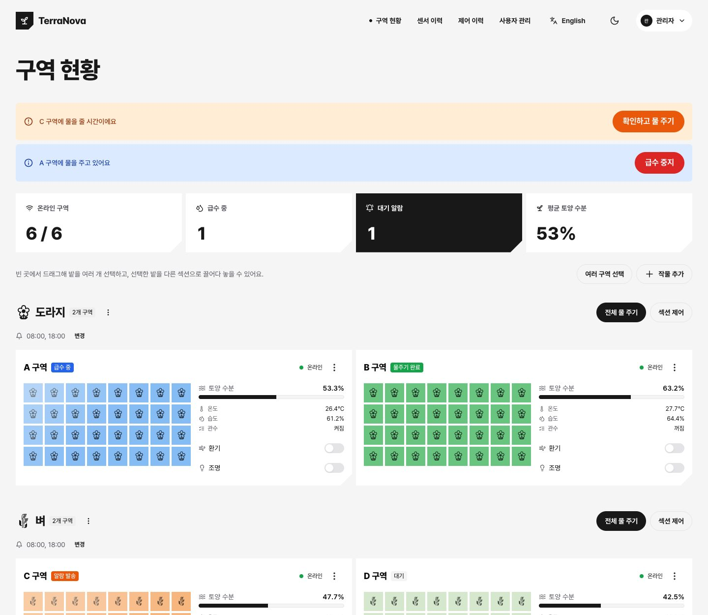
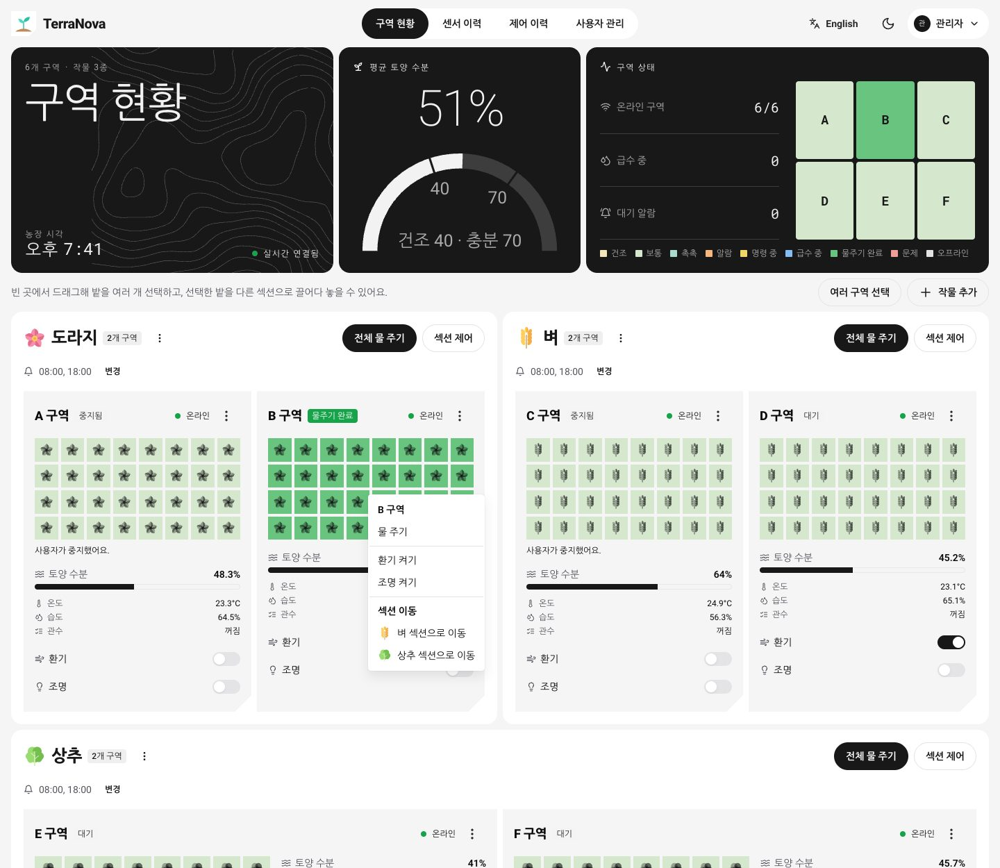
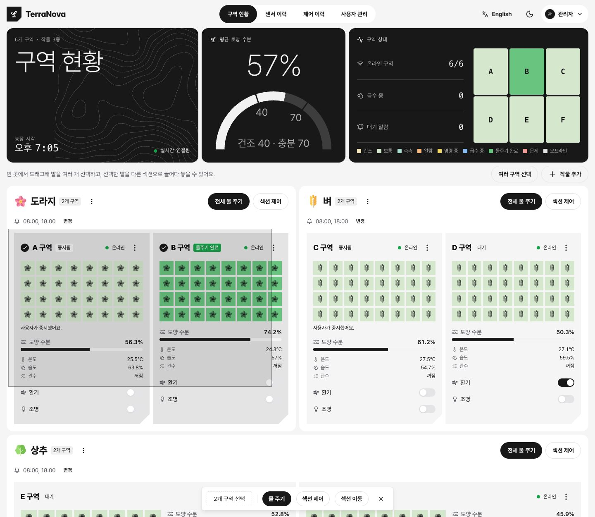
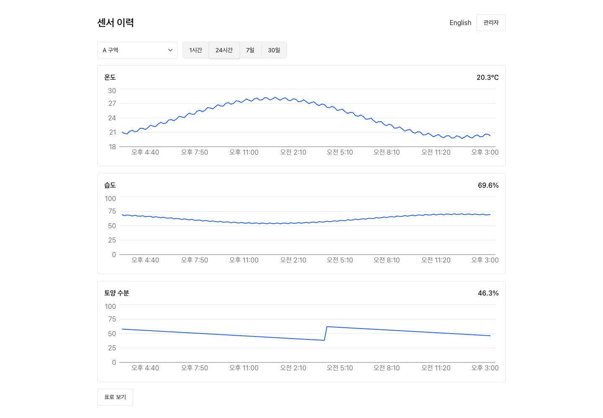
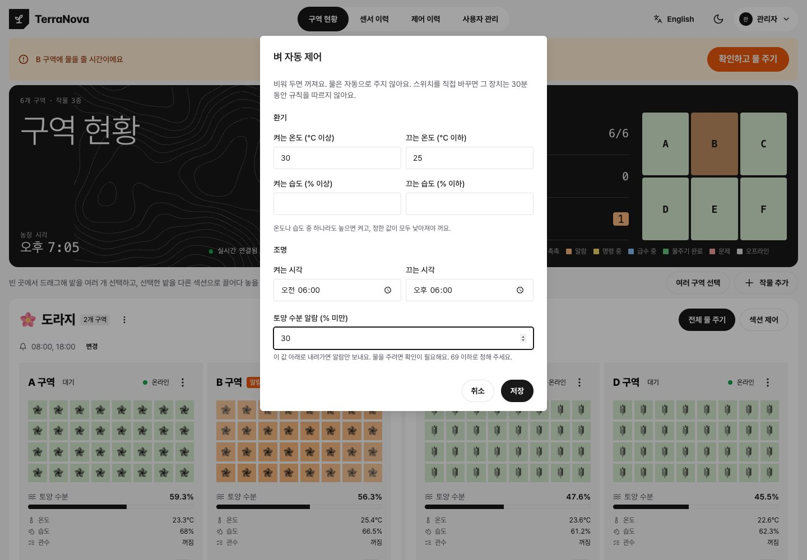
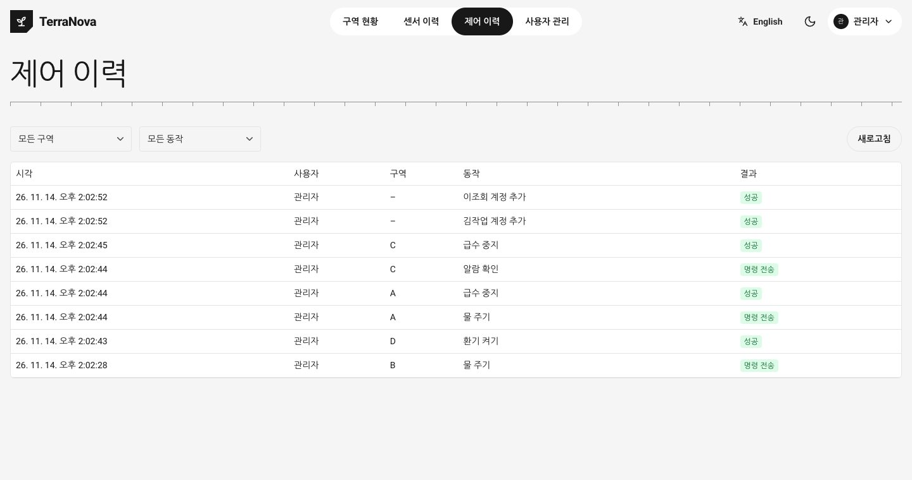
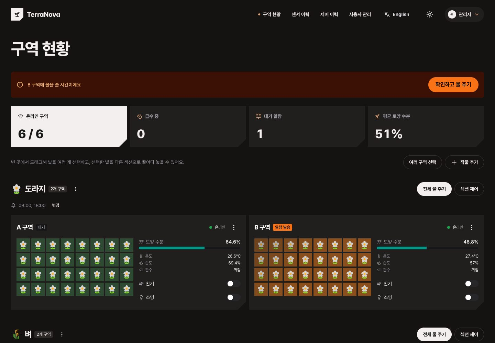
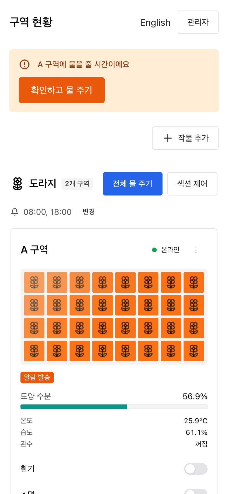

# TerraNova

[](https://github.com/ryushin01/TerraNova/actions/workflows/ci.yml)

스마트팜 제어 애플리케이션입니다. 밭을 그리드로 보여 주고, 정해진 시각에 알람을 보내며, 사람이 확인하면 물을 줍니다.

> **프로젝트 상태:** 포트폴리오 프로젝트입니다. 실제 장비 없이 MQTT 시뮬레이터로 로컬에서 실행하며, 배포는 하지 않습니다. 화면의 구역, 센서 값, 계정은 모두 시뮬레이터와 테스트용 데이터입니다.

## 화면

| 급수 현황 | 밭 우클릭 메뉴 |
|---|---|
|  |  |

| 드래그 선택 | 센서 이력 |
|---|---|
|  |  |

| 자동 제어 | 제어 이력 |
|---|---|
|  |  |

| 다크 모드 | 휴대폰 |
|---|---|
|  |  |

## 주요 기능

| 기능 | 내용 |
|---|---|
| 밭 그리드 | 구역을 작물 아이콘이 든 밭으로 보여 주고, 토양 수분과 급수 상태를 색과 글자로 표시 |
| 알람과 급수 | 섹션별 시각에 알람을 보내고, 사람이 확인하면 물을 주며, 장비 응답에 따라 상태 변경 |
| 일괄 제어 | 우클릭 메뉴, 드래그 선택, 터치와 키보드용 체크박스로 여러 구역을 한꺼번에 제어하고 이동 |
| 섹션과 작물 | 작물별 섹션 관리. 작물을 추가하면 이름에 맞는 아이콘을 자동 선택 |
| 센서 이력 | 온도, 습도, 토양 수분을 기간별 차트와 표로 확인 |
| 자동 제어 | 온도, 습도, 시각 규칙으로 환기와 조명만 제어. 물은 사람의 확인 없이 주지 않음 |
| 알림과 이력 | 웹 푸시 알림, 누가 무엇을 조작했는지 남기는 제어 이력 |
| 계정 | 관리자, 작업자, 조회자 권한과 비밀번호 변경, 재설정, 복구 |
| 화면 | 한국어와 영어, 다크 모드, 휴대폰과 태블릿 대응 |

## 기술 스택


| 구분 | 사용 기술 |
|---|---|
| 웹 | Next.js 16, React 19, Chakra UI 3, Recharts, next-intl, next-themes, react-icons |
| 백엔드 | Bun, Socket.IO, Aedes(MQTT 브로커), Better Auth |
| 데이터 | PGlite, Drizzle ORM |
| 장비 통신 | MQTT (시뮬레이터로 대체) |
| 공통 | TypeScript 7, Bun workspaces, Bun test, Playwright, Biome |

## 시작하기

[Bun](https://bun.sh)이 필요합니다. Docker나 별도 DB 설치는 필요 없습니다.

```sh
bun install
bun run dev        # 전체 실행, 웹은 http://localhost:3000
bun run demo       # 알람이 1분마다 자동으로 오는 시연 모드
```

처음 접속하면 관리자 계정을 만드는 화면이 나옵니다. 공개 가입은 없고, 이후 계정은 관리자가 `사용자 관리`에서 추가합니다.

| 명령 | 설명 |
|---|---|
| `bun run lan` | 휴대폰과 태블릿에서 접속하는 네트워크 모드 |
| `bun run lint` / `typecheck` | 린트와 포맷 검사 / 타입 검사 |
| `bun test` | 단위, 통합 테스트 |
| `bun run test:e2e` | 실제 브라우저 테스트 |

전체 명령과 환경 변수는 [개발 가이드](docs/development.md)를 참고하세요.

## 프로젝트 구조

```text
시뮬레이터(장비) ⇄ MQTT ⇄ 백엔드(브로커 내장, 스케줄러, 로그인, PGlite) ⇄ Socket.IO ⇄ 웹

apps/web         Next.js 대시보드
apps/server      MQTT 브로커, Socket.IO, 급수 흐름, 자동 제어, 로그인, DB
apps/simulator   구역 6개의 센서와 장치 시뮬레이터
apps/lan         네트워크 모드의 HTTPS 프록시
packages/shared  공유 규약과 타입
e2e              브라우저 테스트, 메모리 측정, 스크린샷
```

## 문서

| 문서 | 내용 |
|---|---|
| [기능](docs/features.md) | 화면별 동작, 색상 의미, 권한, 비밀번호 복구 |
| [설계와 안전 규칙](docs/design.md) | 설계 판단, 코드를 바꿀 때 지킬 규칙, 알려진 한계 |
| [네트워크 모드](docs/network.md) | 휴대폰과 태블릿 접속, 신뢰된 인증서로 웹 푸시 켜기 |
| [개발 가이드](docs/development.md) | 명령, 구조, 환경 변수, 데이터, 테스트, 메모리 측정 |
