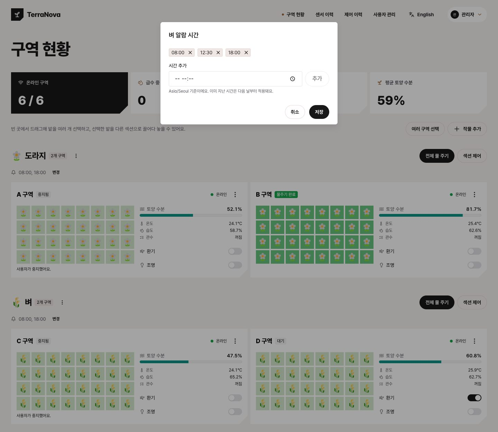
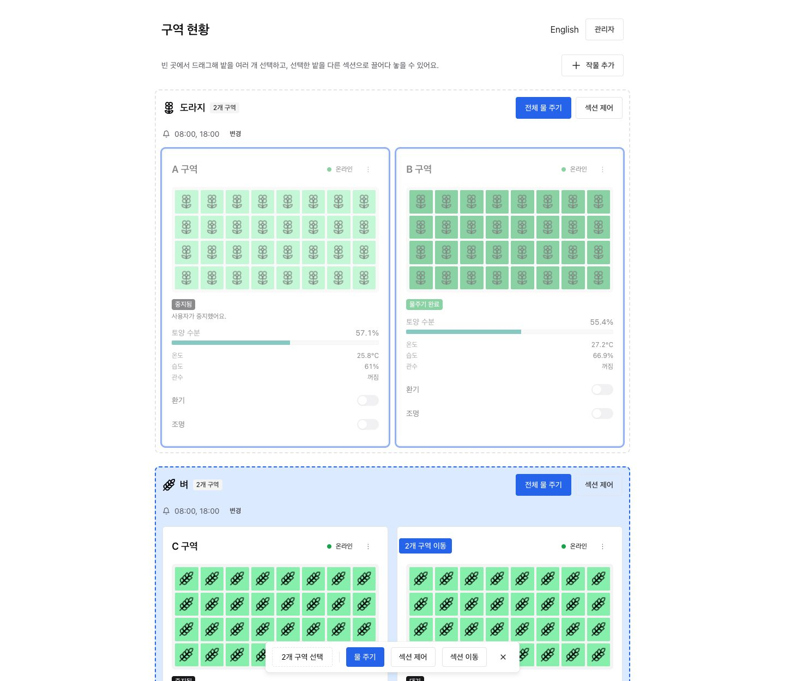
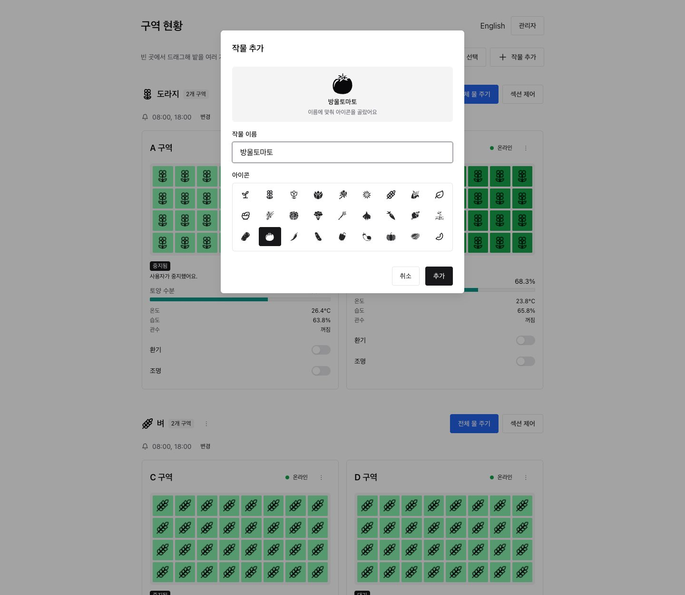
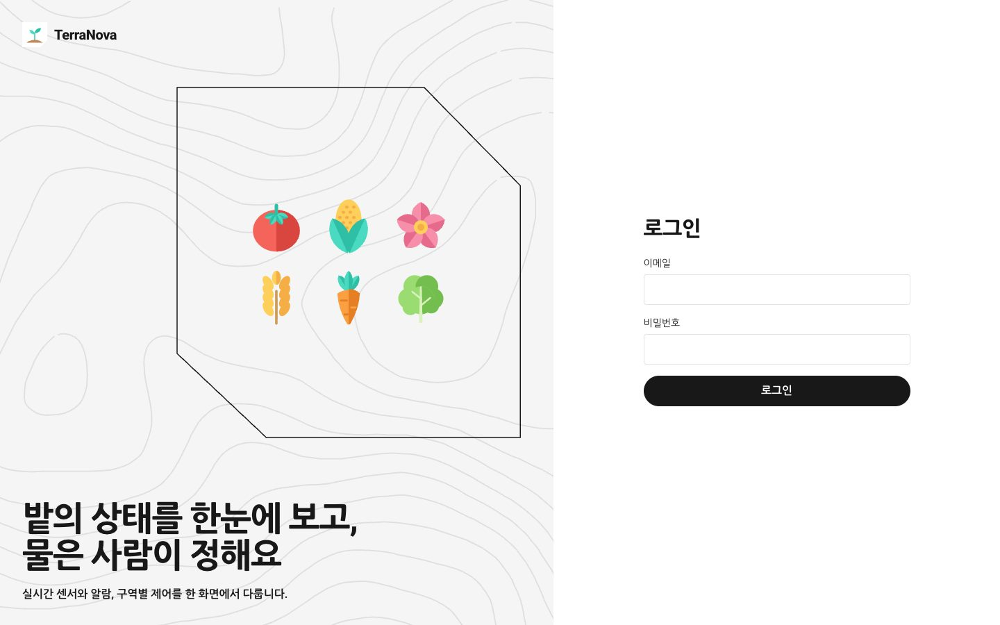
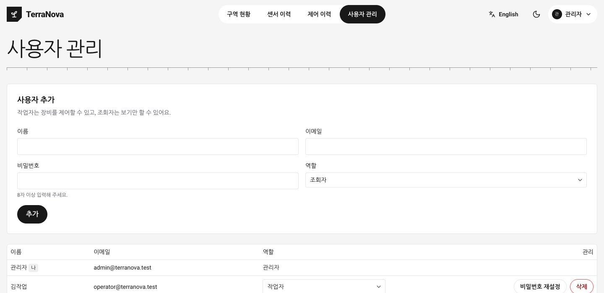

# 기능

화면의 구역, 센서 값, 계정은 모두 시뮬레이터와 테스트용 데이터입니다.

## 밭 그리드

구역마다 8×4칸의 밭으로 표시하고, 칸마다 작물 아이콘이 들어갑니다. 센서가 구역별로 하나이므로 같은 구역의 칸은 모두 같은 상태를 나타냅니다.

| 색 | 의미 |
|---|---|
| 노랑, 초록, 청록 | 평소 토양 수분 (40% 미만, 보통, 70% 이상) |
| 주황 | 알람 대기 |
| 진한 노랑 | 명령 전송 중 |
| 파랑 | 급수 중 |
| 진한 초록 | 물주기 완료 |
| 빨강 | 실패, 시간 초과 |
| 회색 | 오프라인 |

`중지됨`과 `건너뜀`은 별도 색 없이 토양 수분 색으로 표시하고, 카드의 상태 표시로 구분합니다.

## 알람과 급수



섹션마다 정한 시각에 알람이 오고, 확인하면 물을 줍니다. 시각은 섹션 머리글의 `변경`에서 추가하거나 삭제하며(섹션당 최대 12개), 모두 지우면 그 섹션의 정기 알람이 꺼집니다. 저장할 때 이미 지난 시각은 다음 날부터 적용됩니다. 급수 상태는 다음 순서로 진행됩니다.

`알람 발송 → 확인됨 → 명령 전송 → 급수 중 → 물주기 완료` (예외: `실패`, `시간 초과`, `건너뜀`)

알람이 두 개 이상이면 한 줄로 묶어 `모두 확인하고 물 주기`로 한 번에 처리할 수 있고, `개별 보기`로 따로 확인할 수도 있습니다.

아무도 확인하지 않으면 10분마다 다시 알리고, 30분이 지나면 물을 주지 않은 채 `시간 초과`로 기록합니다. 화면을 닫아 둔 사이에 온 알람은 다시 열 때 표시됩니다.

## 메뉴

밭에서 우클릭하거나 길게 누르거나 카드의 `⋮` 버튼을 누르면 물 주기, 급수 중지, 환기와 조명, 섹션 이동 메뉴가 나옵니다.

## 드래그 선택



마우스는 빈 곳이나 선택되지 않은 밭에서 드래그하면 영역 안의 밭이 선택됩니다. 터치와 키보드는 `여러 구역 선택`을 켜면 카드에 나오는 체크박스로 선택합니다. 어느 쪽이든 아래쪽 막대로 한꺼번에 조작합니다.

| 조작 | 동작 |
|---|---|
| 클릭 | 밭 하나 선택 |
| `Shift` + 드래그 또는 클릭 | 선택에 추가 |
| `Cmd/Ctrl` + 클릭 | 선택에 추가 또는 제외 |
| 선택한 밭을 끌어 다른 섹션에 놓기 | 한꺼번에 이동 |
| 선택한 밭 우클릭, 아래쪽 막대 | 물 주기, 중지, 환기, 조명, 이동을 한꺼번에 실행 |
| `Esc` | 드래그 취소 또는 선택 해제 |

## 섹션과 작물



구역은 작물별 섹션으로 묶입니다. 구역을 다른 섹션으로 옮기면 그 구역의 작물도 바뀝니다. 섹션의 `전체 물 주기`와 `섹션 제어`로 일괄 제어합니다.

`작물 추가`에서 이름을 입력하면 아이콘이 자동으로 정해져 미리 보입니다. 키워드는 `packages/shared/src/crop-icons.ts`에 있고, 없는 작물은 새싹 아이콘이 되며 추가 창에서 직접 고를 수 있습니다. 구역이 없는 섹션만 삭제할 수 있습니다. 섹션 이름 옆의 `⋮`에서 이름과 아이콘을 수정하고 섹션 순서를 바꿉니다.

## 센서 이력

상단 메뉴의 `센서 이력`에서 구역별 온도, 습도, 토양 수분을 1시간, 24시간, 7일, 30일 단위 차트와 표로 봅니다. 구역마다 1분에 한 번 기록하고 기간에 맞춰 평균을 내어 보여 줍니다. 기록이 없는 구간은 선이 끊깁니다.

## 자동 제어

섹션 이름 옆 `⋮`의 `자동 제어`에서 정합니다. 비워 두면 꺼집니다.

| 규칙 | 동작 |
|---|---|
| 환기 온도, 습도 | 정한 값 중 하나라도 켜는 값 이상이면 켜고, 모두 끄는 값 이하가 되면 끕니다. 그 사이는 그대로 둡니다 |
| 조명 시각 | 켜는 시각부터 끄는 시각까지 켜 둡니다. 자정을 넘겨도 됩니다 |
| 토양 수분 알람 | 값 아래로 내려가면 6시간에 한 번 **알람만** 보냅니다 |

자동으로 물을 주는 규칙은 없습니다. 스위치를 직접 바꾸면 그 장치는 30분 동안 규칙을 따르지 않으며, 카드에 언제까지인지 표시되고 `자동 제어 다시 켜기`로 바로 풀 수 있습니다. 서버를 재시작해도 풀립니다. 자동 동작은 제어 이력에 `자동 제어`로 남습니다.

## 알림

계정 메뉴의 `알림 켜기`를 켜면 화면을 닫아 두어도 알람과 시간 초과를 브라우저 알림으로 받습니다(Web Push). 로그아웃하면 그 브라우저의 알림은 꺼집니다.

- 브라우저가 신뢰하는 인증서가 필요해 `http://localhost:3000`이나 신뢰된 HTTPS에서만 동작합니다. `bun run lan`의 자체 서명 인증서로는 켜지지 않을 수 있습니다.
- 알림은 브라우저 제조사의 푸시 서비스를 거치므로 이 컴퓨터와 기기 모두 인터넷에 연결되어 있어야 합니다. 내용은 암호화되어 전달됩니다.

## 제어 이력

상단 메뉴의 `제어 이력`에서 누가 언제 어떤 구역을 어떻게 조작했고 결과가 어땠는지 봅니다. 구역과 동작으로 거를 수 있습니다.

- 기록 대상은 사람의 조작입니다: 알람 확인, 물 주기, 급수 중지, 환기와 조명, 구역 이동, 작물 추가와 삭제, 알람 시간 변경, 작물 수정, 섹션 순서 변경, 자동 제어 변경, 비밀번호 변경과 재설정, 사용자 추가와 삭제, 역할 변경. 권한이 없어 거부된 시도도 남습니다. 비밀번호 자체는 기록하지 않습니다.
- `명령 전송`은 장비에 명령을 보냈다는 뜻입니다. 급수의 최종 결과는 카드의 상태로 봅니다.
- 알람 발송, 시간 초과, 응답 없을 때의 자동 중지는 기록하지 않습니다.
- 이름을 함께 저장하므로 계정을 삭제해도 기록은 남습니다. 90일이 지난 기록은 자동으로 지웁니다.

## 화면 모드

처음에는 기기 설정을 따르고, 상단의 달과 해 아이콘(휴대폰에서는 메뉴 안)으로 다크 모드와 라이트 모드를 바꿀 수 있습니다. 선택은 브라우저에 저장됩니다.

## 언어

- 한국어와 영어를 지원합니다. 첫 방문에는 브라우저 언어를 따르고, 둘 다 아니면 한국어로 엽니다.
- 언어를 직접 바꾸면 다음 방문에도 그 선택을 유지합니다.
- 휴대폰에서는 언어와 화면 모드 전환이 메뉴 안에 있습니다.

## 계정과 권한

| 로그인 | 사용자 관리 |
|---|---|
|  |  |

| 역할 | 권한 |
|---|---|
| 관리자 | 장비 제어, 구역 이동, 작물 관리, 제어 이력, 사용자 관리 |
| 작업자 | 장비 제어, 구역 이동, 작물 관리, 제어 이력 |
| 조회자 | 보기만 가능 |

비밀번호는 세 가지 방법으로 바꿉니다. 메일 서버가 없어 메일 링크 방식은 없습니다.

- **내 비밀번호:** 계정 메뉴의 `비밀번호 변경`. 현재 비밀번호를 확인하며, 다른 기기의 로그인은 끊어집니다.
- **다른 사용자:** 관리자가 `사용자 관리`의 `비밀번호 재설정`으로 정합니다. 그 사용자의 로그인은 모두 끊어집니다.
- **관리자 복구:** 비밀번호를 잊은 관리자는 서버를 끄고 이 컴퓨터에서 아래 명령을 실행합니다. 임시 비밀번호가 표시되고 기존 로그인은 끊어집니다. 접속한 뒤 바로 바꿉니다.

```sh
bun run admin:reset-password            # 관리자 계정 목록
bun run admin:reset-password <이메일>
```

## 오류 화면

- 화면에서 오류가 나면 안내와 함께 다시 시도하거나 대시보드로 돌아갈 수 있습니다.
- 없는 주소는 현재 언어의 404 화면을 보여 줍니다.
- 레이아웃까지 실패하면 `global-error.tsx`가 한국어와 영어 안내를 함께 보여 줍니다. 이때는 Chakra와 번역을 쓸 수 없어 기본 스타일로 표시합니다.
