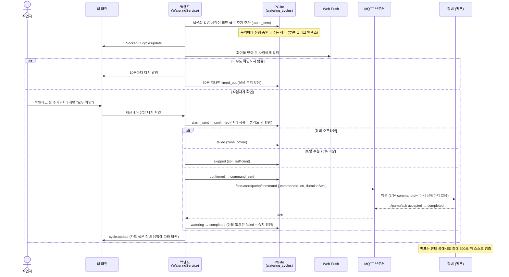
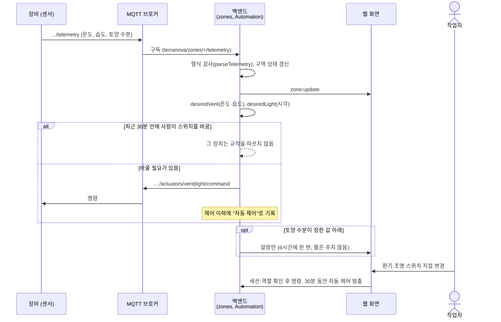

# 시퀀스 다이어그램

TerraNova의 주요 흐름입니다. 웹(Next.js)은 Socket.IO로 백엔드(Bun)와 이어지고, 백엔드는 MQTT 브로커(Aedes)로 장비(개발에서는 시뮬레이터)와 주고받습니다. 지켜야 할 규칙은 [설계와 안전 규칙](design.md)에 있습니다.

## 1. 정시 알람과 확인 후 급수

## 2. 센서 값과 자동 제어

자동 제어는 환기와 조명만 움직이며, 펌프에 명령할 방법이 없습니다.

